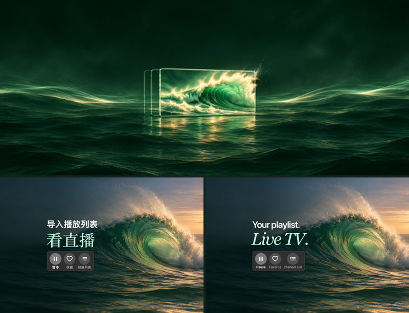

# XPlayer 2.7.0 · 海浪主题商店素材

这套素材用于线上 iOS 2.7.0。标题图将海浪放进玻璃画框，两张搜索图展示该版本实际的暂停、收藏和频道列表控件。下图取自 Apple 上传处理后的预览，上方是标题图，左下是简体中文，右下是英语。



| 展示位 | 商店语言 | 送审 PNG |
| --- | --- | --- |
| 产品页标题 | 英语（美国）、简体中文 | [共用标题图 · 3840 × 1646](exports/XPlayer-Header.png) |
| 搜索结果 | 简体中文 | [导入播放列表，看直播 · 3840 × 2560](exports/XPlayer-Search-zh-Hans.png) |
| 搜索结果 | 英语（美国） | [Your playlist. Live TV. · 3840 × 2560](exports/XPlayer-Search-en-US.png) |

Apple 于 2026-11-26 23:17（北京时间）接收了三张图片的独立审核提交。23:26 回读时，提交与三张图均为 `WAITING_FOR_REVIEW`。核验记录保存了这一时间点的状态、文件大小、尺寸，以及 Apple 预览和本地缩图在 0–255 色阶上的 RGB 通道平均绝对误差。线上展示以获批后版本页的四处关联为准。[核验记录](verification.json) · [送审文件 SHA-256](exports/SHA256SUMS) · [发布步骤](../README.md)

## 重新导出

从仓库根目录执行。成品输出到 `build/app-store/2.7.0/`，可与本目录的送审原件逐张比对。原版环境为 macOS、Node.js 20.20.2 和 Google Chrome 158.0.8127.37。排版使用 macOS 系统字体，Node 依赖由本目录的锁文件固定。

```sh
npm ci --prefix design/app-store/2.7.0
npm --prefix design/app-store/2.7.0 run render
npm --prefix design/app-store/2.7.0 run verify
```

校验命令先对归档原件核对送审 SHA-256，再对新导出核对尺寸、色彩配置和像素。Chrome 合成半透明渐变时，个别 RGB 通道可能相差一个 8 位色阶。校验会报告实测差值，超过一个色阶就给出具体文件和像素位置。需要相同送审字节时直接使用 [exports](exports/) 中的三张图。

修改搜索图时，在导出脚本中编辑各语言的两行文案，在 HTML 模板中调整字体、控件比例和位置。导出时会按 Apple 搜索图安全区检查文字和控件边界。两张底图由 ImageGen 生成，已经随源文件保存。[导出脚本](render.cjs) · [排版模板](source/search.html) · [裁切安全区与控件坐标](source/layout.json) · [底图与原始提示词](source/imagegen-prompts.md)

## 重新截取播放器控件

日常导出直接读取已保存的控件 PNG。需要复核控件时，用 Flutter 3.41.9 在与 2.7.0 标签一致的应用源码上运行下列命令。取图脚本以 390 × 844 的逻辑视口渲染正式的 `PlayerActionsWidget`，校验两种语言的标签，再以 8 倍像素密度截取前三个按钮。输出位于 `build/app-store/2.7.0/controls/`。[2.7.0 播放器源码](https://github.com/TNT-Likely/xplayer/blob/651157ca24568fd0cb3e022e3319838f5faddb7a/lib/presentation/widgets/player_actions_widget.dart) · [取图脚本](source/capture_controls_test.dart)

```sh
flutter pub get
flutter test --no-pub design/app-store/2.7.0/source/capture_controls_test.dart
cmp design/app-store/2.7.0/source/controls-en.png build/app-store/2.7.0/controls/controls-en.png
cmp design/app-store/2.7.0/source/controls-zh.png build/app-store/2.7.0/controls/controls-zh.png
```

取图使用 Flutter SDK 自带的 Roboto 和 Material Icons。简体中文使用 Google Fonts 提供的 Noto Sans SC 字体子集，两个原始字重与 OFL 授权一同归档。[字体与授权](source/fonts/OFL.txt)
